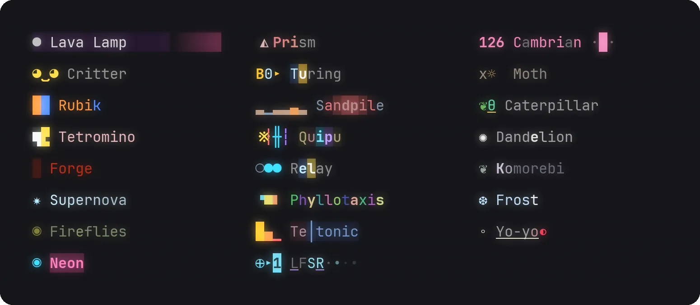

# libshimmer

Animated status lines. Let it shimmer!



Workload-dependent animations, with workload defined by the caller, can spruce up any status line, loading bar or similar.

```rust
use std::time::Duration;

use libshimmer::{Glyphs, Intensity, Motion, Palette, Rgb, Shimmer, Spell, stock};
use libshimmer_ratatui::RowExt as _; // with ratatui, from the libshimmer-ratatui crate

let recipe = stock::named("Lava Lamp").expect("a stock recipe");
let mut shimmer = Shimmer::new(recipe, 7, Glyphs::BASE)?;
shimmer.set_spell(Spell::Busy);
shimmer.show("Compiling");

// Each frame:
shimmer.set_intensity(Intensity::new(tokens_per_second / 100.0));
shimmer.advance(since_last_frame);
let palette = Palette { fg: Rgb::new(208, 208, 208), bg: Rgb::new(21, 21, 21) };
let row = shimmer.status(palette, Motion { mark: true, letters: true });
let spans = row.spans(); // without ratatui, `row.cells()`
row.shade(area, buf);

// When the work ends:
shimmer.set_spell(Spell::Idle);
```

[SPEC.md](SPEC.md) specifies the design, and its §7 what a release may change. MIT-0 licensed.
