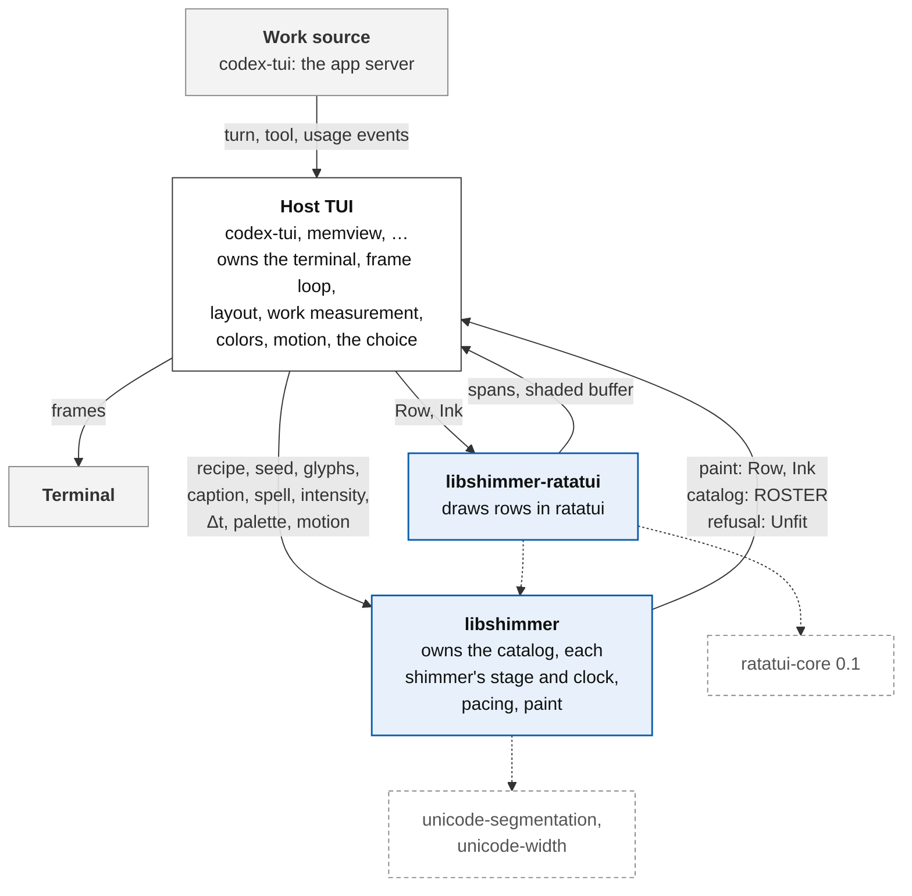
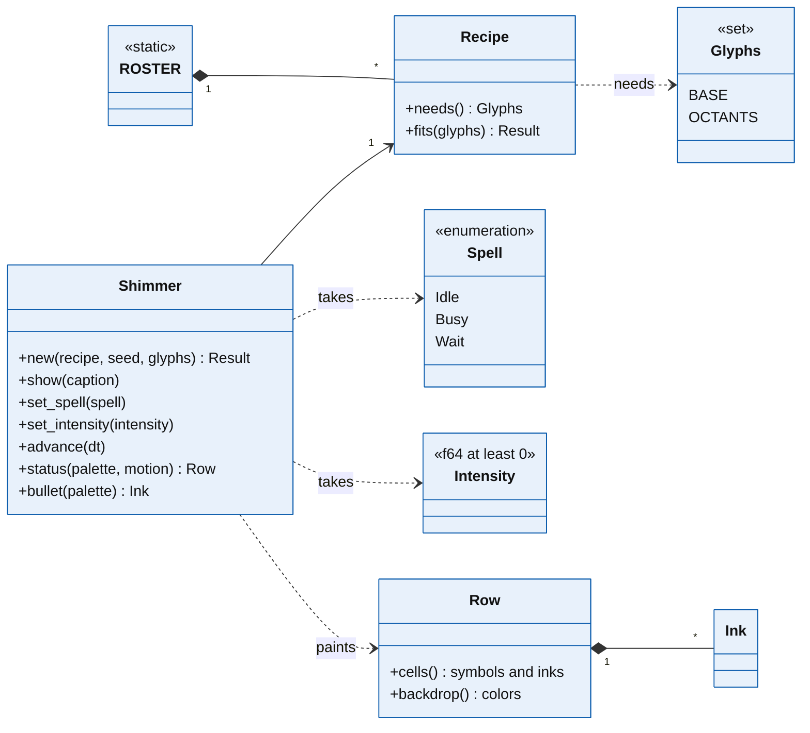
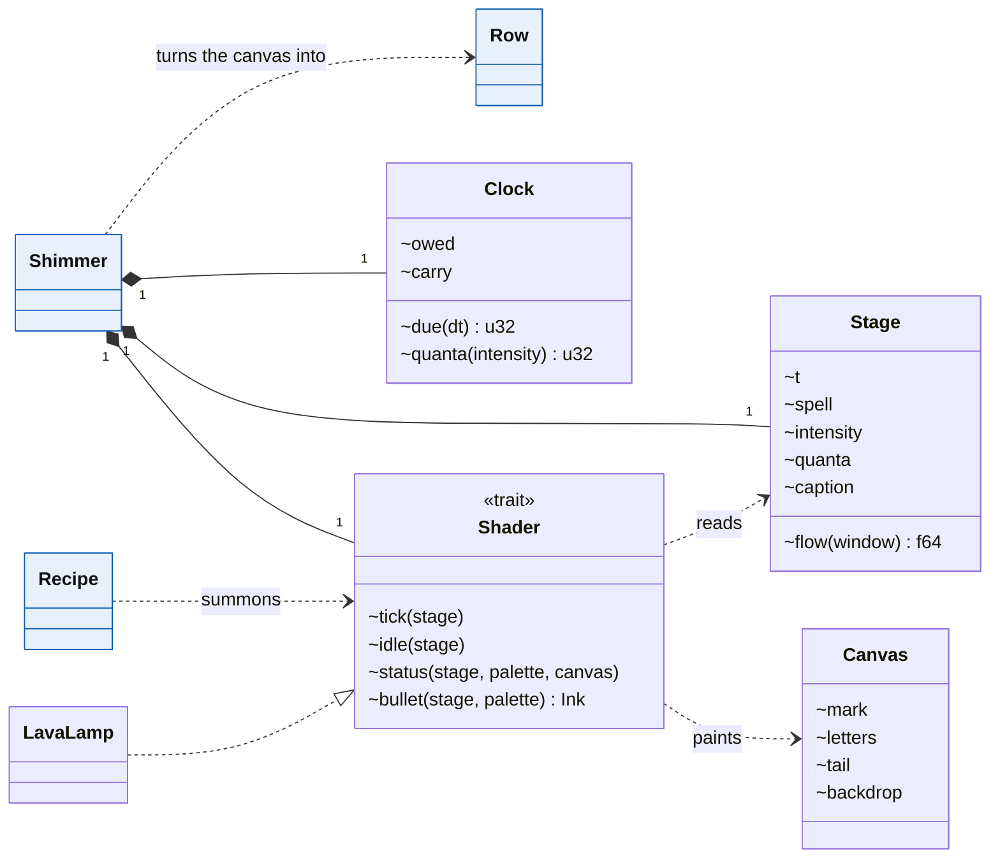
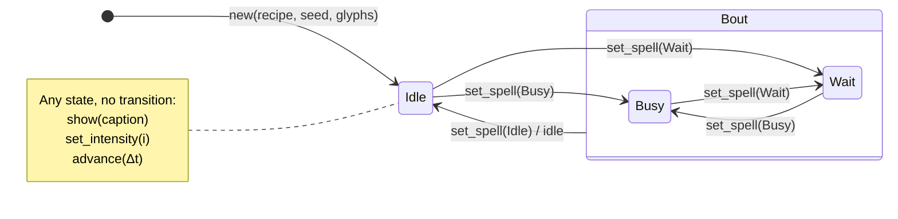
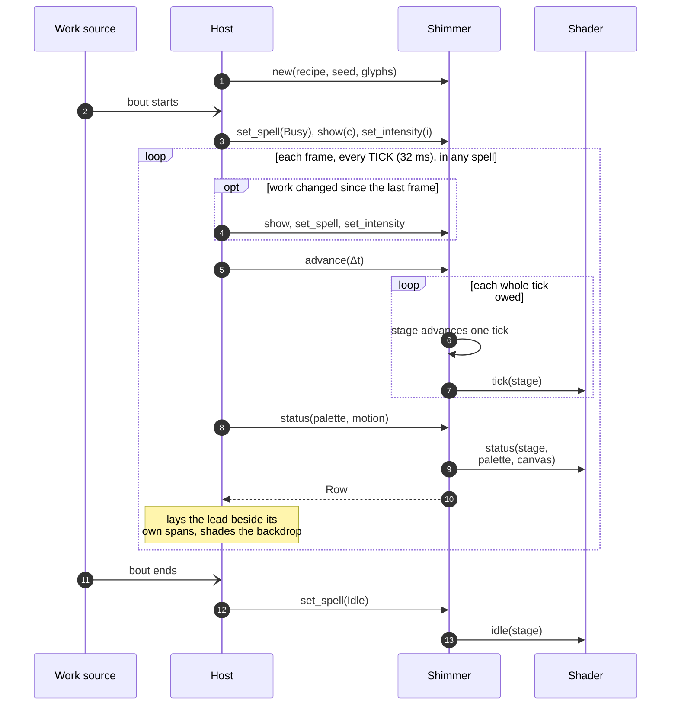

# libshimmer specification

| § | Chapter | Question |
|---|---|---|
| 1 | Synopsis | What is libshimmer, and how does it work? |
| 2 | Boundary | What does libshimmer own, and what crosses its edge? |
| 3 | Nouns | Which types exist, and how do they relate? |
| 4 | Lifecycle | Which states does a shimmer pass through? |
| 5 | Protocol | What does a host do each frame? |
| 6 | Promises | What always holds? |

## 1 Synopsis

libshimmer animates the status line of a terminal program in step with the program's work. A program that uses it is a **Host**, such as codex-tui, the terminal interface of the codex coding agent, or memview.

A **Shimmer** is one running animation. It dresses a **Caption**, the status line's text, such as "Working", and paints the line's **Lead**: a **Mark** of glyphs before the caption, the caption's **Letters**, and a **Tail** of cells after them. Beneath the line it lays a **Backdrop** of background colors. The paint of one cell is an **Ink**, and the paint of the lead and the backdrop together is a **Row**. A shimmer also paints a **Bullet**, the one-cell glyph in front of a running sub-task, such as a tool call.

A shimmer is made from a **Recipe**: a name, a blurb, a credit, and a constructor for the recipe's **Shader**, the animation itself. The **ROSTER** lists the stock recipes, such as Lava Lamp, in the order a picker shows them; hosts cannot add recipes of their own. The host chooses the recipe, through a picker or otherwise, and seeds the shimmer's randomness.

The host tells the shimmer what it is doing. The **Spell** is `Busy` while the host produces, `Wait` while it is blocked on something external, and `Idle` otherwise; a **Bout** is a stretch of `Busy` and `Wait` between two `Idle`s, such as one turn of the codex agent. The **Intensity** is how hard the host works: a number of at least 0, where 1.0 is brisk, measuring whatever the host chooses. libshimmer converts intensity into whole units of paced work, each a **Quantum**. A host that learns of work in lumps, such as a burst of tokens, can pour them into a **Reservoir**, which drains each lump over four seconds. The **Script** is a canned bout and the rest after it, playing in a loop, with which a picker previews a recipe.

A shimmer keeps its own time, in **Ticks** of 32 ms. Each frame, the host passes the time elapsed since the previous frame, and the shimmer's **Clock** converts it into whole ticks; a gap longer than one second counts as one tick. On each tick, the shader reads the **Stage**: the shimmer's time, the caption and its age, the spell and its age, the intensity, and the quanta counted so far. A shader can thus quicken as work intensifies, change while the host waits, and paint `Idle` with an animation of its own; when a bout ends, the shader is told once. Between bouts the shimmer is at **Rest**: its time runs at a quarter of the host's, and its paint settles near grey (§4).

To draw a frame, the host asks the shimmer for its row, passing its **Palette**, the terminal's default foreground and background colors, and its **Motion**, which says whether the mark and the letters may move. Painting changes nothing, and the paint depends only on the recipe, the seed, the commands so far, the palette, and the motion. The host lays the lead beside its own text, such as codex-tui's timer, and shades the line with the backdrop. A row is plain data; a companion crate, libshimmer-ratatui, converts it into ratatui spans and shades a ratatui buffer.

One fact about a host limits which recipes it can run: the glyphs its terminal draws. Some recipes paint glyphs beyond a base set that every target terminal draws; the only such repertoire is Unicode 16's octants, and the host states, as **Glyphs**, the repertoires its terminal draws. Each recipe declares the repertoires it needs. Making a shimmer from a recipe that does not fit the host yields **Unfit** instead, naming what is missing, and a picker can ask beforehand and withhold such a recipe. Captions may hold any grapheme: CJK characters and most emoji are two cells wide, and every recipe paints them well, because paint refuses a substitute glyph whose width differs from the text it replaces.

The host keeps terminal input and output; frame scheduling; the status line's layout; measuring work; detecting the terminal's colors, color depth, and glyphs; the picker; and the user's choice. libshimmer never calls out.

## 2 Boundary

Blue: libshimmer's crates. White: the host. Grey: outside both. Dashed: a Cargo dependency. A solid arrow carries the data on its label in its direction. The host initiates every exchange; libshimmer never calls out.

| Concern | Owner | Crossing |
|---|---|---|
| terminal, frame loop, redraw requests | host | `TICK` advises the frame interval |
| wall time | host | `advance(Δt)` |
| shimmer time: fixed ticks, skipped gaps | libshimmer | none |
| measuring work | host | `set_intensity`, `set_spell` |
| converting intensity into quanta | libshimmer | none |
| caption | host | `show` |
| terminal colors and the truecolor check | host | `Palette`, at paint |
| reduced motion | host | `Motion`, at paint |
| status-line layout and clipping | host | `Row` |
| shimmer choice, persistence, picker | host | `ROSTER`, `Recipe`, `script` |
| randomness | libshimmer, seeded by the host | `seed` |
| stock catalog | libshimmer | `ROSTER` |
| glyphs the terminal draws | host | `Glyphs`, at `Shimmer::new` |
| what each recipe needs | libshimmer | `Recipe::fits`, `Unfit` |

The host passes Δt, and libshimmer owns the fixed-step accumulator and the stale cutoff: reading the wall clock would break P1 to P4, and pickers, reels, and tests run on time that is not the wall's. A row is plain data (`Row`, `Ink`, `Rgb`), so that a host on any toolkit can draw it; libshimmer-ratatui draws it with `ratatui-core` 0.1, the crate ratatui designates for widget libraries, so that libshimmer itself takes no public dependency (§7). The status line's width does not cross: the backdrop holds at most 80 columns, and the host clips the rest. The status timer does not cross either; a host without one need not invent it.

The catalog is closed: `Shader`, `Stage`, and the shaders' shared kit are crate-private. Opening them later is a minor release, and closing them a major one; an open `Shader` would freeze the stage's members.

No terminal query reports which glyphs a terminal draws: terminals report their identity and cursor position, but a missing-glyph box usually advances the cursor as far as the glyph would, and P1 forbids libshimmer a probe anyway. The host takes its `Glyphs` from configuration, the user, or its own table of known terminals. `Glyphs::octant` names the octant repertoire's glyphs, so that a host or tool can print or draw them.

libshimmer is published on crates.io from a public GitHub repository, so that any host, and every machine that builds one, fetches it without credentials.

## 3 Nouns

Blue: public, members marked `+`. Filled diamond: owns, with multiplicities; arrow: refers to; dashed arrow: uses. `Palette`, `Motion`, `Unfit`, `Reservoir`, and the script appear in the glossary only.

The crate-private types inside a shimmer are white, with members marked `~`; blue types repeat from the view above. Dashed arrow with hollow triangle: implements. `LavaLamp` stands for every stock shader. A shader paints a canvas, and the shimmer turns it into a row, applying the motion and refusing any glyph that is not as wide as the text it stands for.

| Term | Meaning |
|---|---|
| Host | A terminal program that uses libshimmer |
| Shimmer | One recipe's shader running on its stage and clock; what a host holds |
| Shader | The animation: reads the stage each tick and paints a row |
| Recipe | Catalog entry: name, blurb, credit, the glyphs it needs, and a constructor for its shader |
| ROSTER | The stock recipes, in picker order |
| Glyphs | A set of glyph repertoires beyond the base set every target terminal draws: those a terminal draws, or those a recipe needs; only octants so far |
| Unfit | Why a recipe cannot load for a host: glyphs the terminal lacks |
| Stage | What a shader reads each tick, as a GPU shader reads uniforms |
| Tick | One 32 ms step of shimmer time |
| Clock | Converts the host's Δt into whole ticks, and intensity into whole quanta; a gap longer than `STALE` yields one tick; at rest, a quarter as many ticks |
| Spell | `Busy`: producing; `Wait`: blocked on something external; `Idle`: no bout |
| Bout | A stretch of `Busy` and `Wait` between two `Idle`s |
| Rest | The stretch between two bouts, while the spell is `Idle`, in which paint settles near grey |
| Lull | The least time between a resting recipe's choreographed moves: five seconds of the host's |
| Intensity | How hard the host works: at least 0, where 1.0 is brisk, the most the stage shows linearly |
| Quantum | One whole unit of paced work, as the stage counts it: 100 a second at brisk intensity, logarithmically more beyond |
| Reservoir | Turns lumps of work into a flow, draining each over 4 s |
| Caption | The text a shimmer dresses |
| Lead | The part of the status line a shimmer paints: mark, letters, and tail |
| Mark | Cells of glyphs before the caption, then a space; absent when the mark may not move |
| Letters | The caption's graphemes as painted, one ink each; a glyph may stand in for a letter as wide |
| Tail | Cells between the letters and the host's text, such as the timer |
| Backdrop | Background colors laid under the line from its first column, whatever text lands there; at most 80 columns |
| Palette | The terminal's default foreground and background |
| Motion | Whether the mark and the letters may move |
| Row | The lead as painted, and the backdrop beneath it |
| Ink | The paint of one cell |
| Bullet | The one-cell glyph in front of a running sub-task, such as a tool call |
| Script | A looping canned bout and rest that previews a recipe |

Intensity is one sticky number beside the spell. libshimmer knows only its value and its normalization: the host decides what it measures, and each shader how it shows it. A later intensity may carry up to three independent channels, each with a canonical projection onto fewer, so that a one-channel shader runs under any host. A host that learns of work in lumps pours them into a reservoir, the one owner of the drain time, and converts the flow into intensity by its own measure; the script drains its lumps the same way.

Paint keeps one restraint across the roster: it styles a cell with color, bold, and underline, never italic, and it never scrambles the caption into other glyphs. A glyph that stands in for a letter belongs to a scene drawn over the caption, such as Fortress's miner or its floods, never to the letter.

## 4 Lifecycle

Transitions read `command / effect`, and `idle` goes to the shader. Setting the current spell again is not a transition. The note's commands change data, not state: a changed caption restarts its age, and `advance` runs the ticks the clock owes. A recipe that does not fit the host yields `Unfit` instead of a shimmer. Ticks and paint run in every state, `Idle` included.

Busy, waiting, and between bouts are exclusive states, so they are one enum, and ending a bout is entering `Idle`, which makes a lost or doubled end impossible (P5). There is no reset: clearing the caption is `show("")`, ending a bout is `set_spell(Idle)`, and a fresh shimmer is `Shimmer::new`. Each shader paints `Idle` as it chooses, and rest settles the paint. A host may hide its status line between bouts or keep it, as codex-tui does, and show the resting paint.

### Rest

Rest gives every recipe one look between bouts: near grey and nearly still. While the spell is `Idle`, shimmer time runs at a quarter of the host's, and whatever the shader paints settles before the host sees it. Each ink settles toward the grey terminals dim text to, the foreground at 60% over the background: it keeps 30% of its departure from that grey, no more saturated than 16% and within 0.04 of the grey's luma. Each background keeps 35% of its departure from the palette's background, under the same saturation. The kept share swells and ebbs by 35% over eight seconds, a bout's paint eases into rest over two, and bold lets go halfway.

A recipe may give rest a choreography of its own. A choreographed move comes at most once a lull and may be a brief burst, such as a moth's two wingbeats; most stock recipes rest still or drift.

## 5 Protocol

Solid arrows are calls, the dashed arrow a return, open arrowheads events. `loop` repeats its contents; `opt` runs them only when its condition holds.

## 6 Promises

| # | Promise | Check |
|---|---|---|
| P1 | libshimmer makes no outbound call: it reads no clock or environment, spawns no thread, keeps no global state, and takes no callback. | clippy's disallowed methods and types; review |
| P2 | Paint is a function of the recipe, the seed, the command sequence, the palette, and the motion. | property test: twin shimmers under one random command sequence paint alike |
| P3 | A shimmer changes only at whole ticks: `advance(a)` then `advance(b)` equals `advance(a + b)` while `a + b` stays within `STALE`. | property test |
| P4 | A gap longer than `STALE` (1 s) advances exactly one tick. | unit test |
| P5 | Each entry into `Idle` calls the shader's `idle` exactly once, when commanded; nothing else calls it. | unit test with a recording shader |
| P6 | Painting changes nothing: `status` and `bullet` take `&self`. | signature |
| P7 | The lead spans `len(mark) + (1 if mark) + width(caption) + len(tail)` columns, and the backdrop at most 80. | by construction: paint refuses a substitute of another width; test across `ROSTER` |
| P8 | With still letters, the letters are the caption verbatim, without styling, and the row has no tail or backdrop; a still mark is absent. | test across `ROSTER` |
| P9 | No caption, intensity, or Δt causes a panic. | `Intensity::new` saturates; property test |
| P10 | Ticks never read colors; colors exist only at paint. | by construction: the stage holds no palette |
| P11 | A recipe paints only the base glyphs and the repertoires it declares. | test across `ROSTER` on every glyph of a scripted take |
| P12 | A blurb spans at most 36 columns, so a picker shows it on one line. | test across `ROSTER` |
| P13 | A `Shimmer` is `Send` and `Sync`, as is every other public type, so a host may keep one on any thread. | compile-time assertion |

## 7 Compatibility

libshimmer follows SemVer from 1.0: a minor release adds, and only a major one breaks. Besides the API and the promises, SemVer covers:

- **Recipe names.** A host persists a recipe by its name, which `stock::named` resolves. Within a major version no recipe is renamed or removed; the roster only grows, and its order is presentation.
- **Paint.** How a recipe paints is not API: a minor release may change it, and P2 makes paint reproducible only within one version. A host that snapshots paint snapshots a still mark and still letters, which P8 fixes to the caption verbatim.
- **ratatui.** libshimmer takes no public dependency. Its ratatui adapter is a crate of its own, libshimmer-ratatui, which stays at 0.x while ratatui-core does: a ratatui-core release that changes the adapter's types breaks the adapter alone.
- **Rust.** The minimum Rust version, `rust-version` in `Cargo.toml`, rises only in a minor release.
- **Growth.** `Spell`, `Ink`, and `Cue` are non-exhaustive, so a minor release may add a spell, a style, or a cue field. `Palette` and `Motion` are complete: the terminal's two default colors, and the two parts of a line that move.
