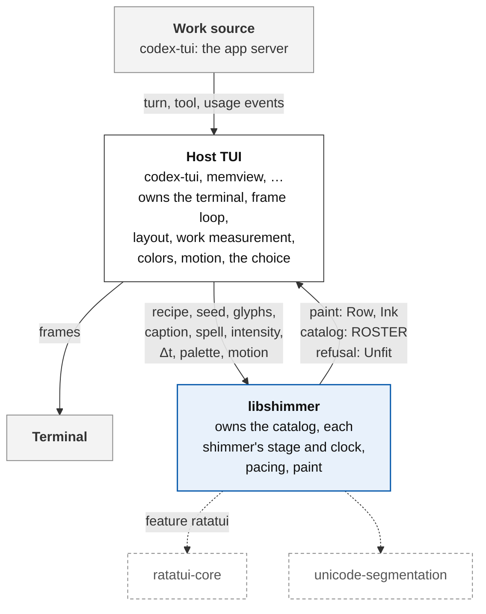
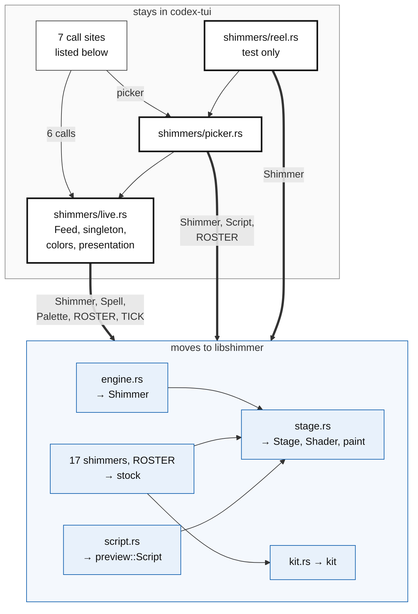
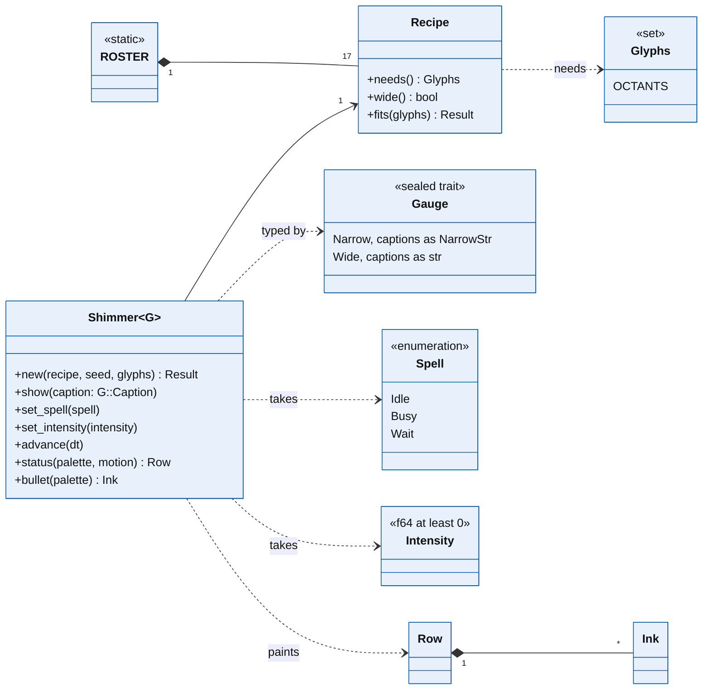
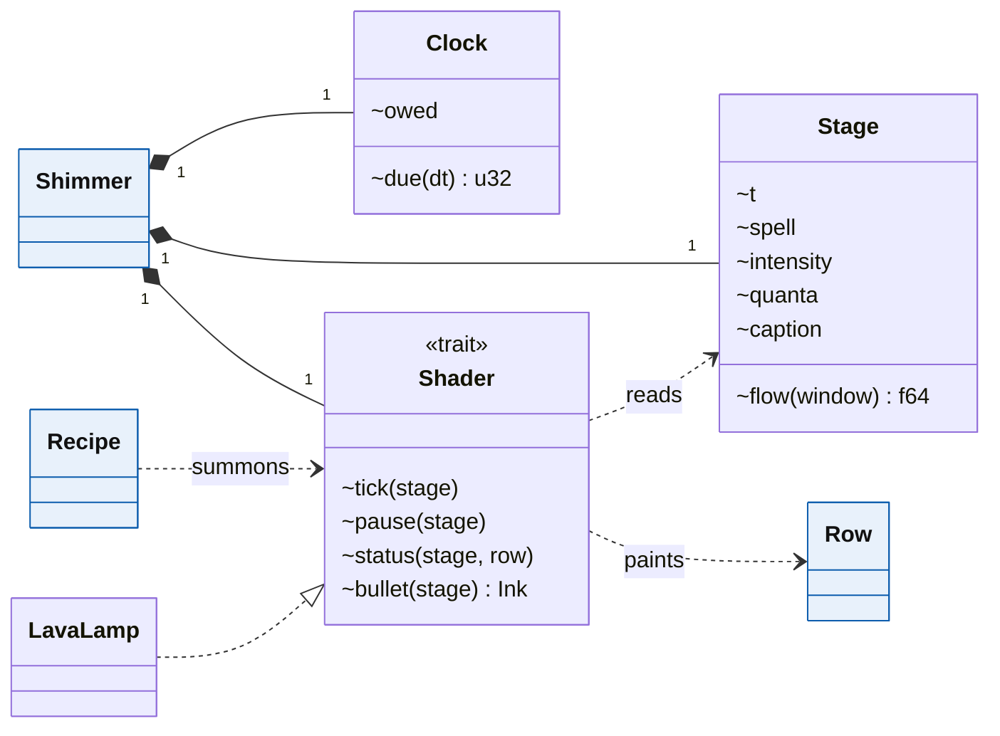
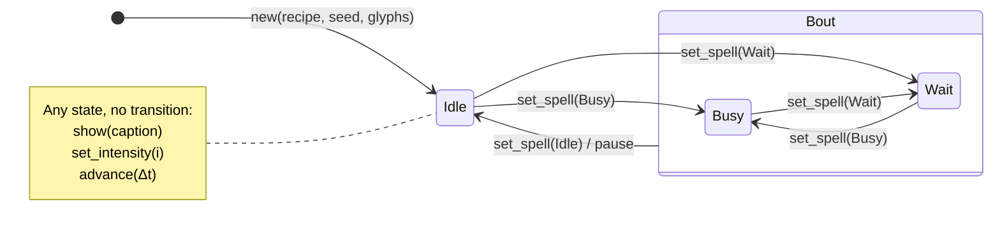

# libshimmer design

Draft 5, 2026-10-20. Moving codex-tui's shimmers into a crate that any terminal UI can use. Draft 5 replaces the remit with a synopsis, and adds the host, the reservoir, and the parts of a lead to the glossary.

<!-- digest -->

| § | Chapter | Question |
|---|---|---|
| 1 | Synopsis | What is libshimmer, and how does it work? |
| 2 | Boundary | What does libshimmer own, and what crosses its edge? |
| 3 | Cut | Where does today's code divide? |
| 4 | Nouns | Which types exist, and how do they relate? |
| 5 | Lifecycle | Which states does a shimmer pass through? |
| 6 | Protocol | What does a host do each frame? |
| 7 | Promises | What always holds? |
| 8 | Decisions | What was chosen over what? |

Answer by handle: "D4: (b)", "P7 is too strong".

## 1 Synopsis

libshimmer animates the status line of a terminal program in step with the program's work. A program that uses it is a **Host**. The animations exist today inside codex-tui, the terminal interface of the codex coding agent; libshimmer moves them into a crate of their own, which memview will also use.

A **Shimmer** is one running animation. It dresses a **Caption**, the status line's text, such as "Working", and paints the line's **Lead**: a **Mark** of glyphs before the caption, the caption's **Letters**, at most one **Insert** cell between two letters, and a **Tail** of cells after them. Beneath the line it lays a **Backdrop** of background colors. The paint of one cell is an **Ink**, and the paint of the lead and the backdrop together is a **Row**. A shimmer also paints a **Bullet**, the one-cell glyph in front of a running sub-task, such as a tool call.

A shimmer is made from a **Recipe**: a name, a blurb, a credit, and a constructor for the recipe's **Shader**, the animation itself. The **ROSTER** lists the 17 stock recipes, such as Lava Lamp, in the order a picker shows them; hosts cannot add recipes of their own. The host chooses the recipe, through a picker or otherwise, and seeds the shimmer's randomness.

The host tells the shimmer what it is doing. The **Spell** is `Busy` while the host produces, `Wait` while it is blocked on something external, and `Idle` otherwise; a **Bout** is a stretch of `Busy` and `Wait` between two `Idle`s, such as one turn of the codex agent. The **Intensity** is how hard the host works: a number of at least 0, where 1.0 is brisk, measuring whatever the host chooses. libshimmer converts intensity into whole units of paced work, each a **Quantum**. A host that learns of work in lumps, such as a burst of tokens, can pass them to a **Reservoir**, which drains each lump into intensity over four seconds. A **Script** plays a canned bout in a loop, with which a picker previews a recipe.

A shimmer keeps its own time, in **Ticks** of 32 ms. Each frame, the host passes the time elapsed since the previous frame, and the shimmer's **Clock** converts it into whole ticks; a gap longer than one second counts as one tick. On each tick, the shader reads the **Stage**: the shimmer's time, the caption and its age, the spell, the intensity, and the quanta counted so far. A shader can thus quicken as work intensifies and change while the host waits; when a bout ends, the shader is told once, and settles.

To draw a frame, the host asks the shimmer for its row, passing its **Palette**, the terminal's default foreground and background colors, and its **Motion**, which says whether the mark and the letters may move. Painting changes nothing, and the paint depends only on the recipe, the seed, the commands so far, the palette, and the motion. The host lays the lead beside its own text, such as codex-tui's timer, and shades the line with the backdrop. A row is plain data; an optional feature converts it into ratatui spans and shades a ratatui buffer.

Two facts about a host limit which recipes it can run: the glyphs its terminal draws, and whether its captions hold wide graphemes. Some recipes paint glyphs beyond a base set that every target terminal draws; today the only such repertoire is Unicode 16's octants, and the host states, as **Glyphs**, the repertoires its terminal draws. CJK characters and most emoji are two cells wide, and the host fixes a **Gauge** in the shimmer's type: `Wide` takes any caption, and `Narrow` takes only a **NarrowStr**, text the host has checked to hold no wide grapheme. Each recipe declares the repertoires it needs and whether it paints wide graphemes well. Making a shimmer from a recipe that does not fit the host yields **Unfit** instead, naming what is missing, and a picker can ask beforehand and withhold such a recipe.

The host keeps terminal input and output; frame scheduling; the status line's layout; measuring work; detecting the terminal's colors, color depth, and glyphs; the picker; and the user's choice. libshimmer never calls out. Two crates do related work: `tui-shimmer`, written for the VT Code coding agent, styles text spans by animation phase, and `tachyonfx` composes time-driven effects for ratatui. Neither takes a measure of the host's work.

## 2 Boundary



Blue: libshimmer. White: the host. Grey: outside both. Dashed: a Cargo dependency. A solid arrow carries the data on its label in its direction. The host initiates every exchange; libshimmer never calls out.

| Concern | Owner | Crossing |
|---|---|---|
| terminal, frame loop, redraw requests | host | `TICK` advises the frame interval |
| wall time | host | `advance(Δt)` |
| shimmer time: fixed ticks, skipped gaps | libshimmer | none |
| measuring work | host; in codex-tui, `Feed` | `set_intensity`, `set_spell` |
| converting intensity into quanta | libshimmer | none |
| caption | host | `show` |
| terminal colors and the truecolor check | host | `Palette`, at paint |
| reduced motion | host | `Motion`, at paint |
| status-line layout and clipping | host | `Row` |
| shimmer choice, persistence, picker | host | `ROSTER`, `Recipe`, `Script` |
| randomness | libshimmer, seeded by the host | `seed` |
| stock catalog | libshimmer | `ROSTER` |
| glyphs the terminal draws | host | `Glyphs`, at `Shimmer::new` |
| whether captions hold wide graphemes | host | the gauge, a type parameter |
| what each recipe needs | libshimmer | `Recipe::fits`, `Unfit` |

## 3 Cut



Thin arrows are calls within a side; thick arrows cross the cut, labelled with the public API they need. A thick border marks a file that stays but changes. The seven calls into `shimmers` keep their signatures, because `live.rs` absorbs the change:

| Caller in `codex-rs/tui/src/` | Calls |
|---|---|
| `chatwidget/protocol.rs` | `observe` |
| `status_indicator_widget.rs` | `dress_status`, `shade_status` |
| `motion.rs` | `tool_mark` |
| `lib.rs` | `engage_random` |
| `startup_draft.rs` | `follow_presentation` |
| `chatwidget/slash_dispatch.rs` | `picker` |

| Today, in `shimmers/` | Destination |
|---|---|
| `stage.rs` | `Stage`, `Shader`, `Spell`, paint types |
| `engine.rs` | `Shimmer`; its span conversion moves to the `ratatui` feature |
| `kit.rs` | `kit`, crate-private |
| `script.rs` | `preview::Script` |
| 17 shimmer files and `ROSTER` | `stock` |
| `live.rs` | stays: `Feed`, the process singleton, color detection, the presentation gate |
| `picker.rs`, `reel.rs` | stay, rebuilt on the public API |

## 4 Nouns



Blue: public, members marked `+`. Filled diamond: owns, with multiplicities; arrow: refers to; dashed arrow: uses. `Palette`, `Motion`, `NarrowStr`, `Unfit`, `Reservoir`, and `Script` appear in the glossary only, and the members of `Row` and `Ink` in the appendix.



The crate-private types inside a shimmer are white, with members marked `~`; blue types repeat from the view above. Dashed arrow with hollow triangle: implements. `LavaLamp` stands for all 17 stock shaders.

| Term | Meaning | Today |
|---|---|---|
| Host | A terminal program that uses libshimmer | codex-tui |
| Shimmer | One recipe's shader running on its stage and clock; what a host holds | `Engine` |
| Shader | The animation: reads the stage each tick and paints a row | trait `Shimmer` |
| Recipe | Catalog entry: name, blurb, credit, the glyphs and gauge it needs, and a constructor for its shader | `Recipe` and `RosterEntry` |
| ROSTER | The stock recipes, in picker order | `ROSTER` |
| Glyphs | A set of glyph repertoires beyond the base set every target terminal draws: those a terminal draws, or those a recipe needs; today only octants | new |
| Gauge | The widest grapheme a shimmer's captions may hold, fixed by the host as a type parameter: `Narrow`, one cell, or `Wide`, two | new |
| NarrowStr | Text checked to hold no grapheme wider than one cell; the caption of a narrow shimmer | new |
| Unfit | Why a recipe cannot load for a host: glyphs the terminal lacks, or captions wider than the recipe paints well | new |
| Stage | What a shader reads each tick, as a GPU shader reads uniforms | `Stage` |
| Tick | One 32 ms step of shimmer time | `TICK` |
| Clock | Converts the host's Δt into whole ticks; a gap longer than `STALE` yields one | `stepped` and `STALE` in `live.rs` |
| Spell | `Busy`: producing; `Wait`: blocked on something external; `Idle`: no bout | `Spell` without `Idle`, plus `pause` |
| Bout | A stretch of `Busy` and `Wait` between two `Idle`s | a codex turn |
| Intensity | How hard the host works: at least 0, where 1.0 is brisk, the most the stage shows linearly | the paced token rate and `KNEE` |
| Quantum | One whole unit of paced work, as the stage counts it | a paced token |
| Reservoir | Turns lumps of work into intensity, draining each over 4 s | the drains in `Feed` and `Script` |
| Caption | The text a shimmer dresses | `header` |
| Lead | The part of the status line a shimmer paints: mark, letters, insert, and tail | unnamed |
| Mark | Cells of glyphs before the caption, then a space; absent when the mark may not move | `mark` in `Row` |
| Letters | The caption's graphemes as painted, one ink each; a glyph may stand in for a letter | `header` in `Row` |
| Insert | One cell at a boundary between two letters, replacing no text | `header_insert` |
| Tail | Cells between the letters and the host's text, such as the timer | `tail` |
| Backdrop | Background colors laid under the line from its first column, whatever text lands there; at most 80 columns | `backdrop` |
| Palette | The terminal's default foreground and background | `Palette` |
| Motion | Whether the mark and the letters may move | the `mark` and `letters` booleans |
| Row | The lead as painted, and the backdrop beneath it | `Row` |
| Ink | The paint of one cell | `Ink` |
| Bullet | The one-cell glyph in front of a running sub-task, such as a tool call | the tool mark |
| Script | A looping canned bout that previews a recipe | `Script` |

## 5 Lifecycle



Transitions read `command / effect`, and `pause` goes to the shader. Setting the current spell again is not a transition. The note's commands change data, not state: a changed caption restarts its age, and `advance` runs the ticks the clock owes (§4). A recipe that does not fit the host yields `Unfit` instead of a shimmer (D14, D18).

## 6 Protocol


Solid arrows are calls, the dashed arrow a return, open arrowheads events. `loop` repeats its contents; `opt` runs them only when its condition holds.

## 7 Promises

| # | Promise | Today | Check |
|---|---|---|---|
| P1 | libshimmer makes no outbound call: it reads no clock or environment, spawns no thread, keeps no global state, and takes no callback. | broken by three shaders' `rand` | clippy `disallowed-methods`; review |
| P2 | Paint is a function of the recipe, the seed, the command sequence, the palette, and the motion. | broken by `rand` | property test: twin shimmers under one random command sequence paint alike |
| P3 | A shimmer changes only at whole ticks: `advance(a)` then `advance(b)` equals `advance(a + b)` while both gaps stay within `STALE`. | holds, in `live.rs` | property test |
| P4 | A gap longer than `STALE` (1 s) advances exactly one tick. | holds, in `live.rs` | unit test |
| P5 | Each entry into `Idle` delivers exactly one `pause` to the shader, when commanded; nothing else delivers one. | new | unit test with a recording shader |
| P6 | Painting changes nothing: `status` and `bullet` take `&self`. | new: `Engine::status` takes `&mut self` | signature |
| P7 | The lead spans `len(mark) + (1 if mark) + width(caption) + (1 if insert) + len(tail)` columns, and the backdrop at most 80. | backdrop tested; lead unverified | paint refuses a substitute of another width (D18); test across `ROSTER` for mark, insert, and tail |
| P8 | With still letters, the lead is the caption verbatim, without styling, tail, or backdrop; a still mark is absent. | holds | test across `ROSTER` |
| P9 | No caption, intensity, or Δt causes a panic. | unverified | `Intensity::new` saturates; property test |
| P10 | Ticks never read colors; colors exist only at paint. | broken by critter's tint | by construction: the stage holds no palette |
| P11 | Apart from D6, D9, D10, and D18's width guard, codex-tui's shimmers paint as before the extraction. | new | the reel's cell export of one scripted take per recipe, compared before and after |
| P12 | Each noun in §4 has one name throughout libshimmer and the fork-owned code of its hosts: no name it replaces survives there. | new | `rg` for each replaced name after the extraction |
| P13 | A recipe paints only the base glyphs and the repertoires it declares. | new | test across `ROSTER` on every glyph of the reel's scripted take |

## 8 Decisions

**D1 Home.** [S] Own repository and crate, `libshimmer`, because other hosts should not depend on a fork of codex. crates.io's `shimmer` is a wikitext parser, and `libgrid` set the naming precedent.

**D2 Paint target.** [D]

- [x] (a) Paint as plain data (`Row`, `Ink`, `Rgb`), with an optional `ratatui` feature built on `ratatui-core`, the crate ratatui designates for widget libraries.
- [ ] (b) Paint as ratatui types throughout.

The reel already flattens paint into cells, and codex-tui and memview both build on ratatui 0.30.2, whose types come from `ratatui-core`, so the feature costs codex-tui nothing.

**D3 Time.** [S] The host passes Δt; libshimmer owns the fixed-step accumulator and the stale cutoff. Reading the wall clock would break P1 to P4, and the picker, the reel, and tests all run on time that is not the wall's.

**D4 Work signal.** [X] The owner chose (a) on 2026-10-20.

- [x] (a) A sticky `Intensity` beside `Spell`.
- [ ] (b) The host pushes whole quanta.
- [ ] (c) The host pushes lumps of work, which libshimmer drains.

The host sets one number whenever it likes, and codex-tui's `Feed` already computes a rate. The number is opaque to libshimmer, which knows only its value and its normalization, where 1.0 is brisk: the host decides what it measures, and each shader how it shows. A later intensity may carry up to three independent channels, each with a canonical projection onto fewer, such as a normalized sum, so that a one-channel shader runs under any host; (a) admits this, and it is not planned. This extends the sketch's two inputs, a text and a scalar, with `Spell`, because `stage.busy()` is the stage member shaders read most (56 reads).

**D5 Openness.** [D]

- [x] (a) Closed catalog: `Shader`, `Stage`, and `kit` stay crate-private.
- [ ] (b) Public `Shader` for third-party shimmers.

Opening later is a minor release and closing a major one, and (b) would freeze the stage's members.

**D6 Randomness.** [S] Each shimmer takes a seed at construction and draws from a crate-internal SplitMix64; the `rand` dependency, used today by lfsr, cambrian, and turing, goes. P2 requires it, and it stops the reel's Turing and Cambrian takes from changing between exports.

**D7 Bout end.** [D]

- [x] (a) `Spell::Idle`, whose entry delivers `pause`.
- [ ] (b) `pause()` beside a two-state `Spell`.

Busy, waiting, and between bouts are exclusive states, so they belong to one enum, which also makes a lost or doubled pause impossible (P5).

**D8 Reset.** [D] No reset command. Clearing the caption is `show("")`; ending a bout is `set_spell(Idle)`; a new shimmer is `Shimmer::new`. Each meaning of "reset" gets its own name.

**D9 Timer.** [D] The status-line timer leaves the stage. Only critter reads it, for a gesture in the first two seconds of each minute, which moves onto shimmer time; hosts without a timer need not invent one.

**D10 Palette.** [D] Colors arrive only at paint. Critter, which smooths a color in `tick` today, smooths blend weights instead. This keeps P10, and codex-tui loses its `Engaged` state, which exists only to wait for colors before constructing an engine.

**D11 Names.** [X] `Engine` becomes `Shimmer`, the trait `Shimmer` becomes `Shader`, the header becomes the caption, and paced tokens become quanta, because the type a host holds should carry the library's name, and a token is a language model's unit. The owner agreed on 2026-10-20, provided the renaming is consistent: each noun in §4 keeps one name throughout libshimmer and the fork-owned code of its hosts (P12). Upstream-owned codex-tui files keep upstream's names, such as the status indicator's `header`, because the fork changes upstream files only at seams; the seam is where a header becomes a caption.

**D12 Painting while idle.** [D]

- [x] (a) As in `Wait`.
- [ ] (b) As in `Busy` at zero intensity.
- [ ] (c) A host error.

Every shader already does (a), because `stage.busy()` is false. codex-tui never paints then; a host that keeps its status line would.

**D13 Line width.** [D] The host does not pass the line's width. The only bound today is a test that holds backdrops to 80 columns, and the host clips the rest; a width input waits for a host that needs one.

**D14 Terminal features.** [X] The owner chose (a) on 2026-10-20. Phyllotaxis and tetromino paint Unicode 16's octants, which a terminal without them shows as missing-glyph boxes, and no terminal query reports which glyphs a terminal draws.

- [x] (a) A fallible loader. Each recipe declares the glyph repertoires it needs beyond a base set every target terminal draws; the host passes those its terminal draws as `Glyphs`; `Shimmer::new` returns `Unfit`, naming what is missing, and `Recipe::fits` answers the same question without constructing, so a picker can withhold the recipe.
- [ ] (b) Fallback paint: a recipe that needs a repertoire also paints without it, octants degrading to quadrants, and the host's `Glyphs` selects the rendition.
- [ ] (c) No declaration: each host keeps its own list of recipes to withhold.

Terminals report their identity (XTVERSION) and cursor position, but a missing-glyph box usually advances the cursor as far as an octant does, so no probe at run time can tell, and P1 forbids libshimmer one anyway. The host takes its `Glyphs` from configuration, the user, or its own table of known terminals. The probe moves before the extraction and widens: print every glyph the stock recipes paint in each target terminal; what renders everywhere becomes the base set, and the rest become declared repertoires (P13). (b) can later serve a recipe worth keeping on terminals that lack a repertoire, without changing (a)'s API.

**D15 Distribution.** [X] The owner chose (a) on 2026-10-20: `libshimmer` on crates.io, published from a public GitHub repository. The name was unclaimed on crates.io that day.

- [x] (a) crates.io, from which any host, and every machine that builds codex-1337, fetches without credentials.
- [ ] (b) A private git dependency, which every such machine must be able to fetch.

**D16 Second host.** [X] The owner chose (a) on 2026-10-20.

- [x] (a) memview, a second ratatui 0.30.2 host, adopts libshimmer in the first release.
- [ ] (b) codex-tui is the only host at first.

A boundary drawn from one host is untested, and a second host exposes what is specific to the first.

**D17 Lumps of work.** [D] codex-tui's `Feed` and `Script` both drain lumps of work over `DRAIN` (4 s) and share that constant today.

- [x] (a) libshimmer exports a `Reservoir` that turns lumps into intensity, used by both.
- [ ] (b) Each keeps its own constant.

(a) gives the concept one owner.

**D18 Wide graphemes.** [X] The owner chose (a) on 2026-10-20. A caption may hold graphemes two cells wide, such as CJK and most emoji. A shader that lays one letter per cell, or puts a one-cell glyph in place of a wide letter, misplaces the timer that follows the lead.

- [x] (a) A gauge as a type. Each recipe declares whether it paints wide graphemes well, and a host fixes its gauge in the type it holds: `Shimmer`, short for `Shimmer<Wide>`, takes any caption and loads only recipes that paint wide graphemes; `Shimmer<Narrow>` loads recipes of both kinds and takes only a `NarrowStr`, text the host has checked. `Shimmer::new` and `Recipe::fits` check the gauge with D14's glyphs.
- [ ] (b) The same declaration, checked at run time: `show` refuses a wide grapheme sent to a recipe that paints only narrow ones.
- [ ] (c) Every recipe paints wide graphemes.

Either way, paint refuses a substitute glyph whose width differs from the grapheme it replaces, so P7 holds for every recipe, and the declaration states where a recipe looks right, not whether the timer moves. (a) costs a host that shows any text nothing, and makes an unchecked caption sent to a narrow shimmer a compile error; (b) finds that mistake at the first wide caption; (c) bans grid shaders by fiat. An audit of the 17 stock recipes found that all paint wide graphemes well under the guard, so all declare wide. Fourteen only color their letters; tectonic also inserts a fault cell between graphemes, which P7 counts and an existing test checks against a caption holding CJK and emoji. Lfsr substitutes bits only for one-cell letters, but it marks any tapped blank with `·`, including the two-cell ideographic space. Critter's sneeze and forge's steam substitute glyphs regardless of width, so today a wide caption moves the timer while either plays; the guard leaves such letters unsubstituted. One reel take per recipe, with a caption mixing narrow and wide graphemes, checks the guard and the declarations.

## Appendix: API sketch and usage

Uncompiled; the first implementation step compiles it.

```rust
pub const TICK: Duration = Duration::from_millis(32);
pub const STALE: Duration = Duration::from_secs(1);

/// `Shimmer` alone is `Shimmer<Wide>`.
pub struct Shimmer<G: Gauge = Wide> { /* recipe, Box<dyn Shader>, Stage, Clock */ }

impl<G: Gauge> Shimmer<G> {
    /// Fails when the terminal lacks glyphs the recipe needs, or when
    /// the gauge is wide and the recipe paints only narrow graphemes.
    pub fn new(recipe: &'static Recipe, seed: u64, glyphs: Glyphs) -> Result<Self, Unfit>;
    pub fn recipe(&self) -> &'static Recipe;

    // Commands. Each input holds until the next command replaces it.
    pub fn show(&mut self, caption: &G::Caption);
    pub fn set_spell(&mut self, spell: Spell);
    pub fn set_intensity(&mut self, intensity: Intensity);
    pub fn advance(&mut self, dt: Duration);

    // Queries.
    pub fn status(&self, palette: Palette, motion: Motion) -> Row<'_>;
    pub fn bullet(&self, palette: Palette) -> Ink;
}

#[derive(Clone, Copy, Debug, Default, PartialEq, Eq)]
pub enum Spell { #[default] Idle, Busy, Wait }

/// How hard the host works; 1.0 is brisk, the most the stage shows linearly.
#[derive(Clone, Copy, Debug, Default, PartialEq, PartialOrd)]
pub struct Intensity(f64);

impl Intensity {
    pub const BRISK: Self = Self(1.0);
    /// NaN and negative levels read as zero.
    pub fn new(level: f64) -> Self;
}

/// The widest grapheme a shimmer's captions may hold. Sealed.
pub trait Gauge { type Caption: ?Sized + AsRef<str>; }
/// One cell: captions arrive checked, as `NarrowStr`.
pub enum Narrow {}
/// One or two cells: captions arrive as `str`.
pub enum Wide {}

/// Text holding no grapheme wider than one cell.
pub struct NarrowStr(str);

impl NarrowStr {
    pub fn new(text: &str) -> Option<&Self>;
}

/// Glyph repertoires beyond the base set every target terminal draws.
#[derive(Clone, Copy, Debug, Default, PartialEq, Eq)]
pub struct Glyphs(u8);

impl Glyphs {
    /// Unicode 16's octants.
    pub const OCTANTS: Self;
    pub fn union(self, other: Self) -> Self;
}

/// Why a recipe cannot load: glyphs the terminal lacks, or a gauge
/// wider than the recipe paints well.
#[derive(Debug)]
pub struct Unfit { /* missing glyphs, gauge */ }

pub struct Recipe { /* name, blurb, credit, needs, wide, summon: fn(u64) -> Box<dyn Shader> */ }

impl Recipe {
    pub fn name(&self) -> &'static str;
    pub fn blurb(&self) -> &'static str;
    pub fn credit(&self) -> &'static str;
    pub fn needs(&self) -> Glyphs;
    /// Whether the recipe paints wide graphemes well.
    pub fn wide(&self) -> bool;
    pub fn fits<G: Gauge>(&self, glyphs: Glyphs) -> Result<(), Unfit>;
}

pub mod stock {
    pub static ROSTER: [Recipe; 17];
    pub fn named(name: &str) -> Option<&'static Recipe>;
}

pub struct Rgb(pub f64, pub f64, pub f64);
pub struct Palette { pub fg: Rgb, pub bg: Rgb }
pub struct Motion { pub mark: bool, pub letters: bool }
pub struct Ink { pub glyph: Option<char>, pub fg: Option<Rgb>, pub bg: Option<Rgb>, pub bold: bool, pub underline: Option<Rgb> }

/// The status line's lead as painted, and the backdrop beneath it.
pub struct Row<'a> { /* caption graphemes and their inks */ }

impl Row<'_> {
    /// Symbols and their inks, left to right.
    pub fn cells(&self) -> impl Iterator<Item = (&str, Ink)>;
    pub fn backdrop(&self) -> &[Rgb];
}

pub mod preview {
    pub struct Script;
    pub struct Cue { pub spell: Spell, pub caption: &'static str, pub intensity: Intensity }
    impl Script {
        pub fn new() -> Self;
        pub fn cue(&self, at: Duration) -> Cue;
    }
}

#[cfg(feature = "ratatui")]
pub mod ratatui {
    impl Row<'_> {
        pub fn spans(&self) -> Vec<Span<'static>>;
        pub fn shade(&self, area: Rect, buf: &mut Buffer);
    }
    impl Ink {
        pub fn span(self, text: &str) -> Span<'static>;
    }
}
```

```rust
// A ratatui host, start to finish. Its configuration says the terminal draws octants.
let glyphs = Glyphs::OCTANTS;
// A picker lists only the recipes that fit.
let offered = stock::ROSTER.iter().filter(|recipe| recipe.fits::<Wide>(glyphs).is_ok());
let mut shimmer: Shimmer = Shimmer::new(stock::named("Lava Lamp").unwrap(), seed, glyphs)?;
shimmer.set_spell(Spell::Busy);
shimmer.show("Compiling");

// Each frame:
shimmer.set_intensity(Intensity::new(tokens_per_second / 100.0));
shimmer.advance(now - last_frame);
let row = shimmer.status(palette, Motion { mark: true, letters: true });
let mut spans = row.spans();
spans.push(timer_span);
Line::from(spans).render(area, buf);
row.shade(area, buf);

// When the work ends:
shimmer.set_spell(Spell::Idle);
```
