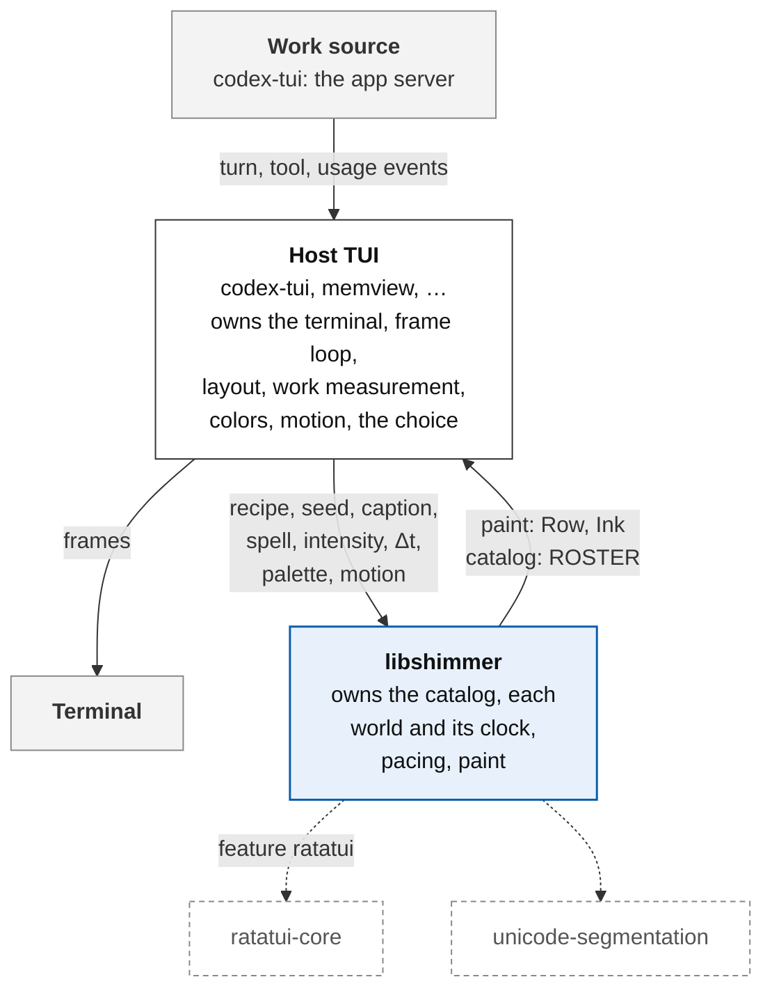
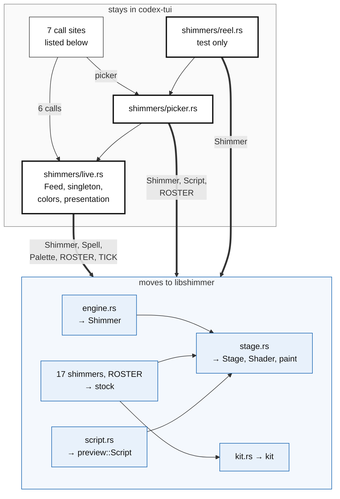
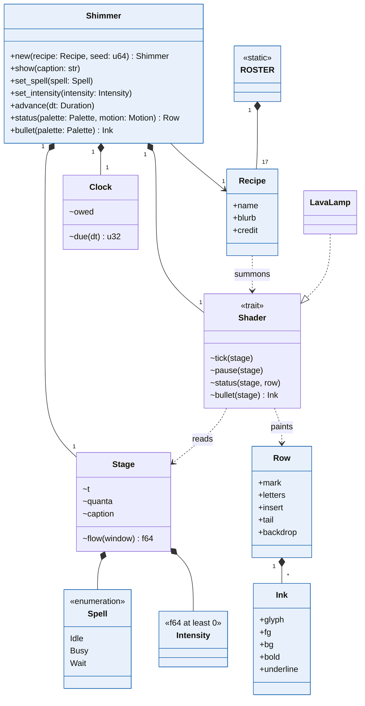
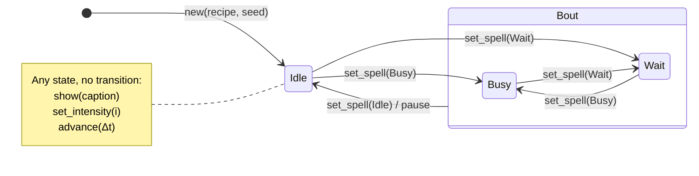
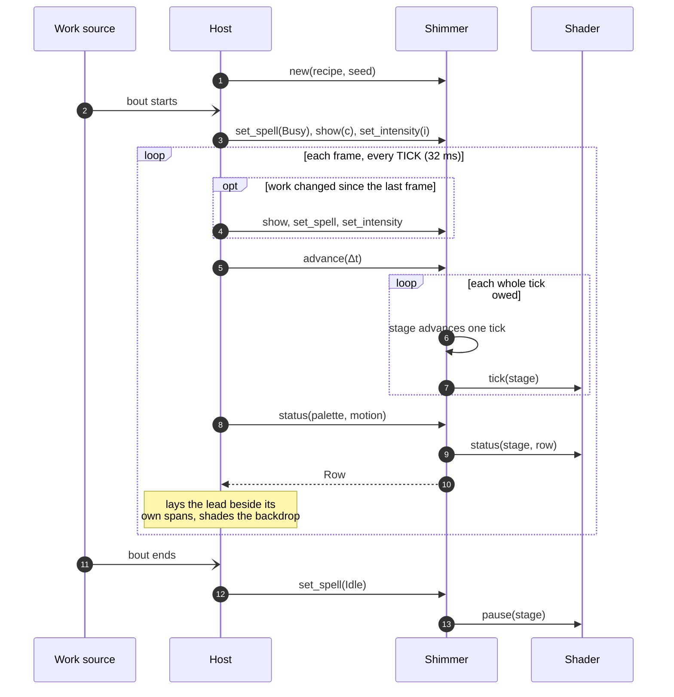

# libshimmer design

Draft 2, 2026-10-20. Moving codex-tui's shimmers into a crate that any terminal UI can use. Draft 2 adopts the vitruvius format: open questions became marked decisions, the cut view moved its callers into a table, and the appendix gained a usage example.

<!-- digest -->

| § | Chapter | Question |
|---|---|---|
| 1 | Remit | What is libshimmer for, and not for? |
| 2 | Boundary | What does libshimmer own, and what crosses its edge? |
| 3 | Cut | Where does today's code divide? |
| 4 | Nouns | Which types exist, and how do they relate? |
| 5 | Lifecycle | Which states does a shimmer pass through? |
| 6 | Protocol | What does a host do each frame? |
| 7 | Promises | What always holds? |
| 8 | Decisions | What was chosen over what? |

Answer by handle: "D4: (b)", "P7 is too strong".

## 1 Remit

**Purpose.** Dress a terminal status line with an animation that follows the host's work.

**Operational principle.** If the host captions its work and reports how hard it is working, then each frame the shimmer paints the caption, a mark, and a backdrop that quicken as work intensifies, change while the host waits, and settle when the bout ends.

**Excluded.** Terminal I/O and frame scheduling; status-line layout; measuring work; detecting terminal colors or color depth; remembering the user's choice; picker UI.

**Prior art.** `tui-shimmer`, written for the VT Code coding agent, styles text spans by animation phase; `tachyonfx` composes time-driven effects for ratatui. Neither takes a measure of the host's work.

## 2 Boundary



Blue: libshimmer. White: the host. Grey: outside both. Dashed: a Cargo dependency. A solid arrow carries the data on its label in its direction. The host initiates every exchange; libshimmer never calls out.

| Concern | Owner | Crossing |
|---|---|---|
| terminal, frame loop, redraw requests | host | `TICK` advises the frame interval |
| wall time | host | `advance(Δt)` |
| shimmer time: fixed ticks, skipped gaps | libshimmer | none |
| measuring work | host; in codex-tui, `Feed` | `set_intensity`, `set_spell` |
| converting intensity into quanta | libshimmer | none |
| caption | host | `show` |
| terminal colors and the truecolor check | host | `Palette`, at paint |
| reduced motion | host | `Motion`, at paint |
| status-line layout and clipping | host | `Row` |
| shimmer choice, persistence, picker | host | `ROSTER`, `Recipe`, `Script` |
| randomness | libshimmer, seeded by the host | `seed` |
| stock catalog | libshimmer | `ROSTER` |

## 3 Cut



Thin arrows are calls within a side; thick arrows cross the cut, labelled with the public API they need. A thick border marks a file that stays but changes. The seven calls into `shimmers` keep their signatures, because `live.rs` absorbs the change:

| Caller in `codex-rs/tui/src/` | Calls |
|---|---|
| `chatwidget/protocol.rs` | `observe` |
| `status_indicator_widget.rs` | `dress_status`, `shade_status` |
| `motion.rs` | `tool_mark` |
| `lib.rs` | `engage_random` |
| `startup_draft.rs` | `follow_presentation` |
| `chatwidget/slash_dispatch.rs` | `picker` |

| Today, in `shimmers/` | Destination |
|---|---|
| `stage.rs` | `Stage`, `Shader`, `Spell`, paint types |
| `engine.rs` | `Shimmer`; its span conversion moves to the `ratatui` feature |
| `kit.rs` | `kit`, crate-private |
| `script.rs` | `preview::Script` |
| 17 shimmer files and `ROSTER` | `stock` |
| `live.rs` | stays: `Feed`, the process singleton, color detection, the presentation gate |
| `picker.rs`, `reel.rs` | stay, rebuilt on the public API |

## 4 Nouns



Blue: public, members marked `+`. White: crate-private, marked `~`. Filled diamond: owns, with multiplicities; arrow: refers to; dashed arrow: uses; dashed arrow with hollow triangle: implements. `LavaLamp` stands for all 17 stock shaders; `Palette`, `Motion`, and `Script` appear in the glossary only.

| Term | Meaning | Today |
|---|---|---|
| Shimmer | One recipe's shader running on its stage and clock; what a host holds | `Engine` |
| Shader | The animation: reads the stage each tick and paints a row | trait `Shimmer` |
| Recipe | Catalog entry: name, blurb, credit, and a constructor for its shader | `Recipe` and `RosterEntry` |
| ROSTER | The stock recipes, in picker order | `ROSTER` |
| Stage | What a shader reads each tick, as a GPU shader reads uniforms | `Stage` |
| Tick | One 32 ms step of shimmer time | `TICK` |
| Clock | Converts the host's Δt into whole ticks; a gap longer than `STALE` yields one | `stepped` and `STALE` in `live.rs` |
| Spell | `Busy`: producing; `Wait`: blocked on something external; `Idle`: no bout | `Spell` without `Idle`, plus `pause` |
| Bout | A stretch of `Busy` and `Wait` between two `Idle`s | a codex turn |
| Intensity | How hard the host works: at least 0, where 1.0 is brisk, the most the stage shows linearly | the paced token rate and `KNEE` |
| Quantum | One whole unit of paced work, as the stage counts it | a paced token |
| Caption | The text a shimmer dresses | `header` |
| Palette | The terminal's default foreground and background | `Palette` |
| Motion | Whether the mark and the letters may move | the `mark` and `letters` booleans |
| Row | The paint of the status line's lead: mark, letters, insert, tail, backdrop | `Row` |
| Ink | The paint of one cell | `Ink` |
| Bullet | The one-cell mark of a running sub-task | the tool mark |
| Script | A looping canned bout that previews a recipe | `Script` |

## 5 Lifecycle



Transitions read `command / effect`, and `pause` goes to the shader. Setting the current spell again is not a transition. The note's commands change data, not state: a changed caption restarts its age, and `advance` runs the ticks the clock owes (§4).

## 6 Protocol



Solid arrows are calls, the dashed arrow a return, open arrowheads events. `loop` repeats its contents; `opt` runs them only when its condition holds.

## 7 Promises

| # | Promise | Today | Check |
|---|---|---|---|
| P1 | libshimmer makes no outbound call: it reads no clock or environment, spawns no thread, keeps no global state, and takes no callback. | broken by three shaders' `rand` | clippy `disallowed-methods`; review |
| P2 | Paint is a function of the recipe, the seed, the command sequence, the palette, and the motion. | broken by `rand` | property test: twin shimmers under one random command sequence paint alike |
| P3 | The world changes only at whole ticks: `advance(a)` then `advance(b)` equals `advance(a + b)` while both gaps stay within `STALE`. | holds, in `live.rs` | property test |
| P4 | A gap longer than `STALE` (1 s) advances exactly one tick. | holds, in `live.rs` | unit test |
| P5 | Each entry into `Idle` delivers exactly one `pause` to the shader, when commanded; nothing else delivers one. | new | unit test with a recording shader |
| P6 | Painting changes nothing: `status` and `bullet` take `&self`. | new: `Engine::status` takes `&mut self` | signature |
| P7 | The lead spans `len(mark) + (1 if mark) + width(caption) + (1 if insert) + len(tail)` columns, and the backdrop at most 80. | backdrop tested; lead unverified | test across `ROSTER` |
| P8 | With still letters, the lead is the caption verbatim, without styling, tail, or backdrop; a still mark is absent. | holds | test across `ROSTER` |
| P9 | No caption, intensity, or Δt causes a panic. | unverified | `Intensity::new` saturates; property test |
| P10 | Ticks never read colors; colors exist only at paint. | broken by critter's tint | by construction: the stage holds no palette |
| P11 | Apart from D6, D9, and D10, codex-tui's shimmers paint as before the extraction. | new | the reel's cell export of one scripted take per recipe, compared before and after |

## 8 Decisions

**D1 Home.** [S] Own repository and crate, `libshimmer`, because other hosts should not depend on a fork of codex. crates.io's `shimmer` is a wikitext parser, and `libgrid` set the naming precedent.

**D2 Paint target.** [D] (a) Paint as plain data (`Row`, `Ink`, `Rgb`), with an optional `ratatui` feature built on `ratatui-core`, the crate ratatui designates for widget libraries. (b) Paint as ratatui types throughout. Chosen: (a). The reel already flattens paint into cells, and codex-tui and memview both build on ratatui 0.30.2, whose types come from `ratatui-core`, so the feature costs codex-tui nothing.

**D3 Time.** [S] The host passes Δt; libshimmer owns the fixed-step accumulator and the stale cutoff. Reading the wall clock would break P1 to P4, and the picker, the reel, and tests all run on time that is not the wall's.

**D4 Work signal.** [O] (a) A sticky `Intensity` beside `Spell`. (b) The host pushes whole quanta. (c) The host pushes lumps of work, which libshimmer drains. Lean: (a): the host sets one number whenever it likes, and codex-tui's `Feed` already computes a rate. This extends the sketch's two inputs, a text and a scalar, with `Spell`, because `stage.busy()` is the stage member shaders read most (56 reads).

**D5 Openness.** [D] (a) Closed catalog: `Shader`, `Stage`, and `kit` stay crate-private. (b) Public `Shader` for third-party shimmers. Chosen: (a). Opening later is a minor release and closing a major one, and (b) would freeze the stage's members.

**D6 Randomness.** [S] Each shimmer takes a seed at construction and draws from a crate-internal SplitMix64; the `rand` dependency, used today by lfsr, cambrian, and turing, goes. P2 requires it, and it stops the reel's Turing and Cambrian takes from changing between exports.

**D7 Bout end.** [D] (a) `Spell::Idle`, whose entry delivers `pause`. (b) `pause()` beside a two-state `Spell`. Chosen: (a). Busy, waiting, and between bouts are exclusive states, so they belong to one enum, which also makes a lost or doubled pause impossible (P5).

**D8 Reset.** [D] No reset command. Clearing the caption is `show("")`; ending a bout is `set_spell(Idle)`; a new world is `Shimmer::new`. Each meaning of "reset" gets its own name.

**D9 Timer.** [D] The status-line timer leaves the stage. Only critter reads it, for a gesture in the first two seconds of each minute, which moves onto shimmer time; hosts without a timer need not invent one.

**D10 Palette.** [D] Colors arrive only at paint. Critter, which smooths a color in `tick` today, smooths blend weights instead. This keeps P10, and codex-tui loses its `Engaged` state, which exists only to wait for colors before constructing an engine.

**D11 Names.** [O] `Engine` becomes `Shimmer`, the trait `Shimmer` becomes `Shader`, the header becomes the caption, and paced tokens become quanta. Lean: as listed, because the type a host holds should carry the library's name, and a token is a language model's unit.

**D12 Painting while idle.** [D] (a) As in `Wait`. (b) As in `Busy` at zero intensity. (c) A host error. Chosen: (a), which every shader already does, because `stage.busy()` is false. codex-tui never paints then; a host that keeps its status line would.

**D13 Line width.** [D] The host does not pass the line's width. The only bound today is a test that holds backdrops to 80 columns, and the host clips the rest; a width input waits for a host that needs one.

**D14 Octants.** [R] Assumes every target terminal draws the Unicode 16 octants that phyllotaxis and tetromino paint. Failure would show as missing-glyph boxes in those recipes. Probe: print one octant line in each target terminal; if any fails, add a quadrant fallback the host can request.

**D15 Distribution.** [O] (a) crates.io, from which any host, and every machine that builds codex-1337, fetches without credentials. (b) A private git dependency, which every such machine must be able to fetch. Lean: (a).

**D16 Second host.** [O] (a) memview, a second ratatui 0.30.2 host, adopts libshimmer in the first release. (b) codex-tui is the only host at first. Lean: (a), because a boundary drawn from one host is untested.

**D17 Lumps of work.** [D] codex-tui's `Feed` and `Script` both drain lumps of work over `DRAIN` (4 s) and share that constant today. (a) libshimmer exports a `Reservoir` that turns lumps into intensity, used by both. (b) Each keeps its own constant. Chosen: (a), so the concept keeps one owner.

**D18 Lead width.** [R] Assumes every shader keeps each letter at its grapheme's width, as P7 promises. Failure would show as a timer that shifts when a shader substitutes a glyph for a wide letter. Probe: P7's test across `ROSTER`, run before the extraction.

## Appendix: API sketch and usage

Uncompiled; the first implementation step compiles it.

```rust
pub const TICK: Duration = Duration::from_millis(32);
pub const STALE: Duration = Duration::from_secs(1);

pub struct Shimmer { /* recipe, Box<dyn Shader>, Stage, Clock */ }

impl Shimmer {
    pub fn new(recipe: &'static Recipe, seed: u64) -> Self;
    pub fn recipe(&self) -> &'static Recipe;

    // Commands. Each input holds until the next command replaces it.
    pub fn show(&mut self, caption: &str);
    pub fn set_spell(&mut self, spell: Spell);
    pub fn set_intensity(&mut self, intensity: Intensity);
    pub fn advance(&mut self, dt: Duration);

    // Queries.
    pub fn status(&self, palette: Palette, motion: Motion) -> Row<'_>;
    pub fn bullet(&self, palette: Palette) -> Ink;
}

#[derive(Clone, Copy, Debug, Default, PartialEq, Eq)]
pub enum Spell { #[default] Idle, Busy, Wait }

/// How hard the host works; 1.0 is brisk, the most the stage shows linearly.
#[derive(Clone, Copy, Debug, Default, PartialEq, PartialOrd)]
pub struct Intensity(f64);

impl Intensity {
    pub const BRISK: Self = Self(1.0);
    /// NaN and negative levels read as zero.
    pub fn new(level: f64) -> Self;
}

pub struct Recipe { /* name, blurb, credit, summon: fn(u64) -> Box<dyn Shader> */ }

impl Recipe {
    pub fn name(&self) -> &'static str;
    pub fn blurb(&self) -> &'static str;
    pub fn credit(&self) -> &'static str;
}

pub mod stock {
    pub static ROSTER: [Recipe; 17];
    pub fn named(name: &str) -> Option<&'static Recipe>;
}

pub struct Rgb(pub f64, pub f64, pub f64);
pub struct Palette { pub fg: Rgb, pub bg: Rgb }
pub struct Motion { pub mark: bool, pub letters: bool }
pub struct Ink { pub glyph: Option<char>, pub fg: Option<Rgb>, pub bg: Option<Rgb>, pub bold: bool, pub underline: Option<Rgb> }

/// The status line's lead as painted, and the backdrop beneath it.
pub struct Row<'a> { /* caption graphemes and their inks */ }

impl Row<'_> {
    /// Symbols and their inks, left to right.
    pub fn cells(&self) -> impl Iterator<Item = (&str, Ink)>;
    pub fn backdrop(&self) -> &[Rgb];
}

pub mod preview {
    pub struct Script;
    pub struct Cue { pub spell: Spell, pub caption: &'static str, pub intensity: Intensity }
    impl Script {
        pub fn new() -> Self;
        pub fn cue(&self, at: Duration) -> Cue;
    }
}

#[cfg(feature = "ratatui")]
pub mod ratatui {
    impl Row<'_> {
        pub fn spans(&self) -> Vec<Span<'static>>;
        pub fn shade(&self, area: Rect, buf: &mut Buffer);
    }
    impl Ink {
        pub fn span(self, text: &str) -> Span<'static>;
    }
}
```

```rust
// A ratatui host, start to finish.
let mut shimmer = Shimmer::new(stock::named("Lava Lamp").unwrap(), seed);
shimmer.set_spell(Spell::Busy);
shimmer.show("Compiling");

// Each frame:
shimmer.set_intensity(Intensity::new(tokens_per_second / 100.0));
shimmer.advance(now - last_frame);
let row = shimmer.status(palette, Motion { mark: true, letters: true });
let mut spans = row.spans();
spans.push(timer_span);
Line::from(spans).render(area, buf);
row.shade(area, buf);

// When the work ends:
shimmer.set_spell(Spell::Idle);
```
